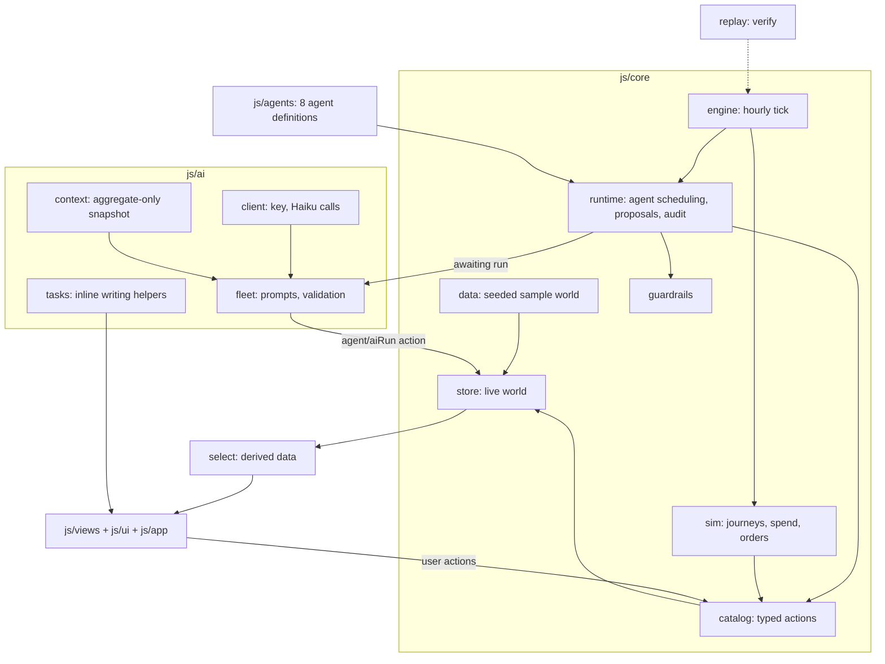

# Architecture

Marketing Cloud is a static site. There is no build step, no modules and no backend. Everything runs in the browser as classic-script IIFEs that attach to one global, `window.MC`. React 18 and htm (in `vendor/`) render the views.

## Overview

## Modules and load order

`index.html` loads scripts in this order, and each layer may use only the ones above it. `tools/smoke.js` and `tools/e2e.js` read this list from the page.

1. `vendor/`: React, React DOM, htm.
2. `js/core/`: namespace, util, time, rng, catalog, store, models, segments, copy, data, guardrails, sim, select, runtime, engine, replay.
3. `js/ai/`: client, context, fleet, tasks.
4. `js/ui/`: icons, kit, charts, flow, agent-ui.
5. `js/agents/`: optimizer, sendtime, pacer, guard, scout, copy, analyst, planner. Each registers a definition with the runtime.
6. `js/views/`: home, campaigns, content, audiences, analytics, console (the Agents screen), connect.
7. `js/app.js`: shell, navigation by bare hash (`#home`, `#campaigns`, `#content`, `#audiences`, `#analytics`, `#agents`), approvals drawer, boot.

`smoke.js` loads only `core/` and `agents/` in a Node `vm` context, which is why those layers must not touch the DOM at load.

## World, actions and determinism

- **World.** `MC.data` builds the Fernway Outfitters world from a seed (`MC.SEED`): 6,000 profiles in columnar arrays, 60 days of history, segments, campaigns, variants and agent entities. `MC.store` holds the live world and notifies subscribers once per batch.
- **Actions.** Every change, from a person or an agent, is a typed action in `MC.catalog` with a validator, a copy-on-write reducer and an inverse. User actions go through `dispatchUser`, which stamps `{seq, tick}` and appends to `world.log`. Undo uses the inverse.
- **Determinism.** All randomness comes from keyed forks of `MC.rng` (seeded sfc32), and time is a tick counter (1 tick = 1 world hour). No `Math.random` or wall clock reaches the world. Seed plus the action log reproduces the same state.
- **Replay.** `MC.replay.verify` replays the log headlessly and compares digests of state and of the audit chain. It is a dev utility with no UI. Results, not requests, are logged: an AI decision is stored in the action payload (`agent/aiRun`), so replay never calls the API.

## Engine tick and catch-up

`MC.engine.advance(world)` is the one tick pipeline, shared by the live app and replay: increment the tick, run the day roll at hour 0, run `MC.sim.step` (journeys, paid response curves, organic orders, attribution), then `MC.runtime.runDue`, which runs the agents whose cadence is due.

On boot the engine generates the world from the seed, then runs `catchUp` in chunks of 48 ticks until the world reaches the current real date and hour (`catchUpTarget`). The sample season runs Nov 7 to Dec 31, 2026; outside it the world stays at its start. Display dates are anchored to that season's real calendar, so state digests do not depend on the boot date. After boot the clock runs at one tick per 1.2 seconds. The UI has no clock controls; the overflow menu offers "Jump ahead", and "Reset sample data" regenerates the world.

## Agents runtime and guardrails

An agent definition (`js/agents/*.js`) supplies `observe`, candidate generation, parameters, cadence, an autonomy range and the guardrails it needs. `MC.runtime` does the rest for every agent:

- Runs it on cadence with a forked RNG, records a trace of what it saw and decided.
- Turns candidates into proposals after materiality, cooldown (after a rejection) and dedupe checks, with a newer proposal on the same target superseding the old one.
- Evaluates guardrails (`MC.guardrails`): the base set (`consent`, `protectDrafts`, `targetFresh`, `holdout`) plus the agent's own. Blocking failures stop the proposal.
- Routes by autonomy: Off drops it, Suggest queues it for approval, Autopilot applies it through the catalog if it is not `mustQueue` and its risk is within the agent's limit.
- Measures realized impact against a static holdout cohort and writes a chained audit entry (FNV-1a digests) for each run.

## The Haiku bridge

`MC.ai.client` stores the key (`mc.ai.key` in localStorage or sessionStorage), makes raw `fetch` calls to `api.anthropic.com/v1/messages` with a JSON schema for structured output, limits requests to three at once and keeps a usage and cost meter. `MC.ai.isOn()` is true only after a key verifies.

When AI is on and an agent's `aiMode` is not `rules`, `runAgent` still computes rule-based candidates, but records the run as awaiting in `world.ai.pending` and calls `MC.ai.fleet.enqueue`. The fleet builds a context, asks Haiku to pick, tune within declared ranges and explain, validates the answer, and dispatches one logged `agent/aiRun` action. The runtime then sends the verdict down the normal proposal path, so guardrails, approvals and undo apply unchanged. Copy written by Haiku is always queued for approval.

Fallback: no key, an 8-second timeout, a refusal, invalid JSON, a failed validation or a missing result all dispatch `agent/aiRun` with `fallback: true`, and the rule-based drafts are used for that run. The UI never waits on the AI beyond the deadline.

Context is aggregate only. `MC.ai.context` builds a stable cached prefix (brand book, guardrails, action catalog) and a per-call snapshot, and `scrub()` turns profile-level fields and long id lists into counts before anything is sent. `MC.ai.tasks` provides inline helpers for views (variant writing, brief from text, segment from text, explain), each falling back to the rule-based version. Details are in [AI-FLEET.md](AI-FLEET.md).

## Views and design rules

Views read the world through `MC.select` (memoized selectors) and hooks such as `useSelect` and `useUi`, and change it only by dispatching catalog actions. Ephemeral UI state (theme, route, dismissed notes) lives in `MC.uiStore` and persists to `localStorage` under `mc.ui.v1`; the world itself is not persisted, so a reload regenerates it. Editors keep drafts in component state and show a conflict chip rather than overwrite them when the world changes underneath.

Design rules (full list in [CONTRACT.md](CONTRACT.md) §11):

- The simulation is invisible: dates and relative times, never ticks, seeds or digests.
- No glassmorphism, left-edge stripes, gradients, glow or emoji. Sentence case. One primary button per region.
- Agents are attributed calmly: a small dot and hover text, one "What changed" feed, one approvals count, batched toasts for autopilot only.
- Type is Schibsted Grotesk, self-hosted; tokens are in `css/tokens.css`, with light and dark themes.
