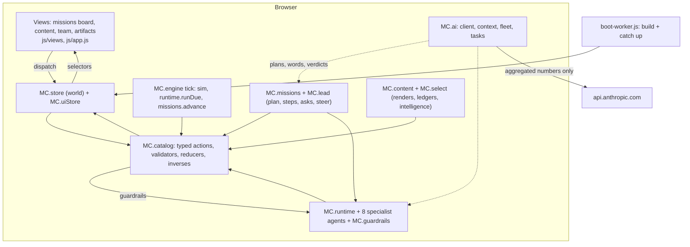

# Architecture

A static, no-build app: classic-script IIFEs that attach to `window.MC`, React 18 and htm from `vendor/`, no modules and no bundler. The product thesis (agents work visibly on missions, people steer and decide) is in [AGENTIC.md](AGENTIC.md); this file explains how the code delivers it.

## Modules and load order

`index.html` is the source of truth. Scripts load in this order, each with `?v=MC.BUILD` (`MC.BUILD` is set in `js/core/namespace.js`; bump it and every `?v=` in `index.html` together on each deploy).

1. `vendor/`: React, React DOM, htm.
2. `js/core/`: `namespace` (the `MC` object, `MC.SEED`, `MC.BUILD`), `util`, `time`, `rng`, `catalog`, `store`, `models`, `segments`, `copy`, `content`, `data`, `guardrails`, `sim`, `select`, `missions`, `runtime`, `engine`, `replay`.
3. `js/config.js`: deployment configuration, loaded before the AI client.
4. `js/ai/`: `client`, `federation`, `context`, `fleet`, `tasks`.
5. `js/ui/`: `icons`, `kit`, `charts`, `flow`, `agent-ui`.
6. `js/agents/`: `optimizer`, `sendtime`, `pacer`, `guard`, `scout`, `copy`, `analyst`, `planner`, then `lead`. The first eight register with `MC.runtime`; `lead` is the orchestrator used by missions.
7. `js/views/home.js` and `js/app.js`.

Other views (`mission`, `content`, `campaigns`, `audiences`, `analytics`, `console`, `connect`, `tour`) and their stylesheets load the first time their route opens (`app.js`, `loadLazy`). `js/core/boot-worker.js` is not in `index.html`: the engine starts it as a Web Worker (see below).

Node tools load the same files by reading the `src` attributes of `index.html` (the core, agents and ai directories), so a new script must be added there to be tested.

## World, catalog, determinism

- The **world** is one object in `MC.store`: profiles and metrics (columnar, mutated in place with a revision bump), plus entity slices (segments, campaigns, variants, content, agents, proposals, missions, feed, insights, audit) that are copy-on-write.
- Every change, from a person or an agent, is a **catalog action** (`MC.catalog.apply`): typed, validated, reduced copy-on-write, with an inverse for undo and an audit entry. Examples: `campaign/create`, `block/update`, `message/publish`, `mission/answer`.
- **Determinism:** the world is generated from `MC.SEED` (20261107). Actions from people (origin user) are logged with the tick; actions from agents and missions are not logged because they are deterministic functions of the world and tick. Where a result is not deterministic (Claude's plan or words), the result itself goes into the logged payload, never the request.
- **Replay** (`MC.replay.run`): regenerate from seed, apply logged actions at their ticks while advancing, and compare state digests (`digestWorld`) and the audit chain with the live session. The engine stores a checkpoint digest at each day roll. `node tools/smoke.js 500` must report 0 audit errors and identical output across two runs.

## Engine: tick and catch-up

One tick is one world hour. `MC.engine.advance(world)` is the shared pipeline (live and replay): `sim.dayRoll` at hour 0, `sim.step` (sends, orders, revenue), `runtime.runDue` (agents whose cadence is due), then `missions.advance`. The wall-clock scheduler (`tickOnce`) fires one tick per `PACE_MS` (1,200 ms) in one store batch, so subscribers get one notification per tick; an overrun skips ahead instead of queueing. The pace is not exposed in the UI; `E.setSpeed` and `E.step` exist for headless tests and development.

Boot builds the world and catches it up to the real date: `E.catchUpTarget` maps today's date and hour onto the sample season (Nov 7 to Dec 31, 2026, last day 54; outside it the world stays at the start) and `catchUp` advances in 12-tick chunks. When `Worker` is available over http(s), the same generate and catch-up code runs in `boot-worker.js` (which loads the core and agent scripts and posts the finished world back); otherwise it runs in-thread. Phases shown while booting: profiles, history, scores, agents, catch-up.

## Missions

`js/core/missions.js` (engine, world slice `missions`) and `js/agents/lead.js` (the rules brain).

- **Plan:** `MC.lead.plan(world, text)` parses a sentence into an objective (metric: reactivations, revenue, orders, signups or unsubs; a target; a deadline), constraints (`maxDiscountPct`, `maxSpend`, `excludeChannel`, `maxSendsPerWeek`) and a plan from one of five templates (winback, launch, event, grow, protect). Steps have a kind owned by an agent (audience: Segment Scout, campaign: Campaign Planner, copy: Copy Drafter, guard: Fatigue Guard, sendtime: Send-Time Tuner, pacer: Budget Pacer, monitor: Insight Analyst, goal and handoff: Lead) and `needs` that define the dependency graph. Anything it cannot parse becomes a clarifying ask. With Claude on, `MC.ai.tasks.planFromGoal` returns the same shape; it is validated and its result travels in the `mission/create` payload.
- **Execution is event-driven.** Each tick, a step whose `needs` were done at the start of the tick is claimed (queued to working, with a hand-off beat from the producing agent); on the next tick its executor runs real catalog actions as that agent and the step goes to done, blocked (waiting on an ask), or skipped (after two failed attempts). Independent steps progress in parallel. There are no durations or delays added for display.
- **Asks** (`mission/ask`, `mission/answer`) carry the question, why, impact range and options, and wait for a person. **Steer** (`mission/steer`) merges new constraints and re-plans, with Lead's reply recorded as beats. `mission/setStatus` handles pause and resume.
- **Monitoring:** when no step is open the mission enters its monitoring phase. At 09:00 each day Insight Analyst checks in, recomputes progress (value, target, forecast, interval) and Lead re-plans on drift, at most once every three days and three times in total.
- **Seed:** two missions exist at boot (a win-back mid-execution with an ask waiting, and Black Friday Early Access in monitoring), built over existing campaigns.

## Content

`js/core/content.js` (pure helpers), catalog actions `block/*` and `message/*`, and selectors in `js/core/select.js`. Detail is in [CONTENT.md](CONTENT.md).

- **Model:** blocks (headline, body, offer, cta, image, product, claim, signoff) with tags, review state and version history; messages assemble blocks into slots with per-channel overrides. Channels are email, sms, push, social and web.
- **Renders** are computed, never stored: `MC.content.render(world, messageId, channel)` returns the channel's fields, the blocks used and `MC.copy.check` results against `MC.copy.LIMITS`. A variant remains the delivery record: `message/publish` renders a message into variants carrying `messageId`, `channel` and `renderedVer`, so sim, optimizer and analytics keep working. Editing a block a live variant uses marks the variant as having a newer version available.
- **Ledgers:** `world.content.perf`, `fat` and `exp` are written only by the simulator. They record exposures, results and per-person reuse for each block and channel, driven by seeded latent effects (a base effect, a channel interaction and a reuse decay). They are never written by actions and the UI invents no number.
- **Intelligence selectors:** `contentPerformance`, `contentMatrix`, `blockFatigue`, `whereUsed`, `contentContrast` and `contentRecommendations`, with intervals and "not enough data" states. The Content view (Library, Compose, Intelligence) and agents read the same selectors.

## Agents, runtime, guardrails

- `MC.runtime` registers the eight specialists. Each has a cadence, an autonomy (off, suggest, autopilot) and a track record. A run observes the world, computes candidates deterministically and turns them into proposals, which are routed by autonomy.
- **Guardrails** (`js/core/guardrails.js`) evaluate every proposal and every mission step action: consent, frequency cap, quiet hours, max change per run, minimum sample, keeps a variant live, budget cap, protects drafts, brand and compliance, unchanged since proposed, suppression limit, and holdout. Copy written by Claude always queues for review. Undo and realised-impact measurement apply to agent work like any other change.
- **Missions reuse the specialists:** a mission step calls the same planner, copy and scoring code and dispatches catalog actions with origin `agent:<id>`.

## Claude bridge, auth, relay

`js/ai/`, specified in [AI-FLEET.md](AI-FLEET.md).

- `client.js` (`MC.ai`) is a raw `fetch` client for `POST https://api.anthropic.com/v1/messages` with model `claude-haiku-5-5`, structured output, at most three requests in flight, and a usage meter. It never rejects; failures resolve with an error and the caller falls back to rules.
- **Auth mode:** the user's own API key, sent as `x-api-key`, kept in localStorage or sessionStorage ("Remember on this device"), verified with one 16-token call. The CSP in `index.html` allows `connect-src 'self' https://api.anthropic.com` only.
- `context.js` builds a cached stable prefix plus a per-call snapshot and scrubs everything sent: profile-level fields become counts, so only aggregates leave the browser. `fleet.js` validates responses (known candidate ids, ranges, copy checks, numbers grounded in engine values) and dispatches `agent/aiRun`. `tasks.js` provides `planFromGoal`, `writeVariants`, `briefFromText`, `segmentFromText` and `explain`.
- With `world.ai.on`, a run waits for its verdict (8 s budget per request) and otherwise completes with the rule drafts. `ai/setEnabled` and `agent/aiRun` are logged, so replay needs no network.
- Dormant company sign-in code exists for organisations (`js/ai/federation.js`, `tools/wif-relay/`); it is off unless `MC.CONFIG.federation` is set in `js/config.js`.

## Views and design rules

- `app.js` owns the shell: a top bar (product mark, mission switcher with "New goal", Asks count, Team, Artifacts menu with Campaigns, Audiences, Content and Results, Connect Claude, overflow), the Asks drawer, error boundaries, and the bare-hash router (`#missions`, `#missions/<id>`, `#missions/new`, `#team`, and the artifact routes such as `#content`).
- `views/mission.js` draws the board: lanes by agent, blocks by dependency depth, wires from each step's real `needs`, baton chips from real step output, the narration column, the ask card, and the Lead column for steering and new goals.
- `views/content.js` has Library, Compose and Intelligence. Compose keeps a local draft and dispatches catalog actions only on explicit clicks.
- Design rules are in [DESIGN-DIRECTION.md](DESIGN-DIRECTION.md): the goal sentence is the headline, the ask is the only dark surface, motion only to show something just changed, and no glass or blur, curved left-edge stripes, decorative gradients, sparkle icons, emoji, KPI-tile walls or sidebar of objects. No play, pause, replay, playhead, countdown or added delay.

## Tests

`tools/smoke.js` (boot and advance, audit errors, determinism), `missions-test.js`, `content-test.js`, `agent-eval/run.js` (stubbed model responses through the validator), `auth-test.js`, `check-config.js` (config against CSP), and the Playwright suites `e2e.js` and `auth-e2e.js`.
